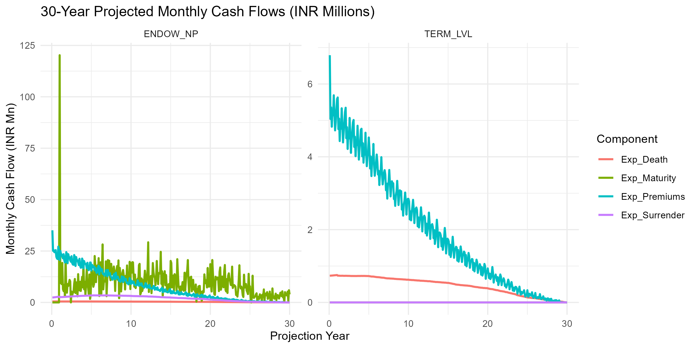
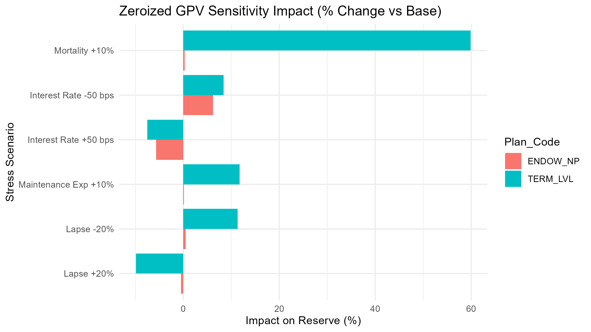

# Life-Insurance-GPV-ValuationModel

An end-to-end actuarial cash flow projection and Gross Premium Valuation (GPV) engine built in **R (`tidyverse`, `ggplot2`)** across 5,000 synthetic Level Term and Without-Profit Endowment policies.

## Repository Contents
* **`life_gpv_valuation_model.R`**: Complete end-to-end valuation script covering synthetic model-point generation, data validation/exception logging, select-and-ultimate multiple-decrement tables, 30-year monthly cash flow projections, sensitivity stress testing, and a 1-year Analysis of Change (AoC) roll-forward.
* **`outputs/`**: Exported valuation summaries, sensitivity matrices, AoC roll-forward tables, and diagnostic charts.

## Key Actuarial & Governance Features
* **Data Validation Pipeline:** Quarantines corrupt policy records (invalid sums assured, matured policies, age limit breaches) into an exception log prior to cash flow projection.
* **Control Checks:** Verifies `1.0000` total exit probability run-off per policy and reports both Unfloored GPV (economic Best Estimate Liability) and Zeroized GPV (statutory floor).
* **Risk & Movement Analysis:** Evaluates reserve sensitivity across $\pm 50\text{ bps}$ interest rate shifts, $+10\%$ mortality, $\pm 20\%$ lapses, and $+10\%$ maintenance expenses, alongside a 1-year reserve roll-forward.

## Visual Outputs
### 30-Year Projected Cash Flow Profile

### Reserve Sensitivity Matrix

